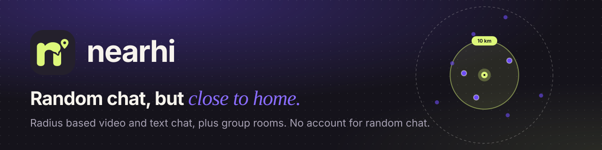

# NearHi

**Talk to someone near you, right now.** Open the site, press start, and you're on a video call with a stranger who is within the distance you chose. No sign-up, no app, nothing to install. There are also group **rooms** for people who want to talk in a bigger circle.

### 👉 [nearhi.in](https://nearhi.in)

Runs in the browser on your phone or laptop (Chrome, Safari, Edge, Firefox). 18+ only.

## How to use it

1. Open [nearhi.in](https://nearhi.in) and press **Start talking**.
2. Pick how far away you're happy to meet someone, from 10 km to anywhere, and allow your location and camera when the browser asks.
3. You're connected with the next person searching within range. Chat by text or video. **Skip** moves you to someone new, **Stop** ends it and turns your camera off.

NearHi is new, so there may not be many people online at any moment. If you're alone, pick **Anywhere**, or send the link to a friend and both press Start at the same time.

## Rooms

Rooms are group chats with text and video, for when you want more than one stranger at a time.

- **Open or link only.** A public room is listed on the Rooms page with a **Join this room** button. A link only room is not listed and is reachable only through its link.
- **Sizes.** Up to 6 people in a video room, up to 30 in a text only room.
- **The owner is the admin.** The person who opens a room sets its rules, can let anyone in or approve each person, lock the room, and remove or ban anyone. If the owner leaves for more than a minute, the room closes.
- **A free account is needed for rooms.** Sign in with Google and choose a username, so owners can manage who is inside. Random chat still needs no account.

## What makes it different

Most random chat sites match you with anyone in the world. NearHi matches you by distance. You choose the radius, and you're only paired with someone whose own radius reaches you too, so you don't end up in a call with someone far outside the distance you chose.

Phones and laptops often guess their location a few kilometres off. NearHi allows for that, and warns you before you start if your device's location is rougher than the radius you picked.

## Safety and privacy, in plain words

- **Adults only.** NearHi is for people 18 and over. It cannot check anyone's age, so a minor could still press the button. Rooms ask you to confirm you are 18 or older when you create your username. If you see a minor, press Report or write to us.
- **Automatic screening, not live watching.** Chat messages and small stills from the video are checked automatically for harmful content. It misses things and sometimes flags harmless ones, and nobody watches calls live. Use **Report** if someone behaves badly. Reported browsers and accounts are reviewed and can be banned.
- **No account for random chat, no recordings.** Random chat asks for no name, email or phone number. Rooms need a Google sign-in: we keep your Google ID, email, username and the time you confirmed you are 18 or older, and you can delete your account at any time from the Rooms page. Video goes directly between browsers and is never recorded by us. Chat text is not stored.
- **Your location** is used only to find people in range, and is removed once you're matched, skip, or leave. The other person is never told it. Rooms do not use your location.
- **Other people can see your IP address during a video call**, which can roughly reveal your city. That is how direct video calls work. Use a VPN if that bothers you.

Read the full [Terms of Use](https://nearhi.in/terms/) and [Privacy Policy](https://nearhi.in/privacy/).

## Contact

Questions, reports, or a request about something that involves you: **nearhi.in@gmail.com**

---

## For developers

This repository is the code behind the live site. You don't need it to use NearHi. If you want to read it, run it, or host your own copy, here's the short version.


**Stack**

- **Backend:** FastAPI. One WebSocket endpoint for random matching, chat relay and WebRTC signaling (`main.py`).
- **Matching:** Redis geo commands (`GEOADD` / `GEOSEARCH`), mutual radius check, atomic pairing with a Lua script.
- **Video:** WebRTC peer to peer, STUN by default, TURN pluggable through `/ice-servers`. Rooms use a mesh (everyone connects to everyone), which is why video rooms stop at 6.
- **Rooms and accounts:** `rooms.py` (WebSocket rooms, video mesh signaling, owner controls, bans, screening) and `accounts.py` (Google sign-in, sessions, usernames, SQLite). Rooms live in memory, accounts in `data/nearhi.db`.
- **Frontend:** the landing page and the legal pages are a Next.js app in `web/`, exported to static files. The chat app (`/talk/`) and the rooms pages (`/rooms/`) are plain HTML, CSS and JavaScript in `web/public/`. Light and dark theme, self-hosted fonts.
- **Moderation:** OpenAI's moderation endpoint for chat text and sampled video stills, manual bans through a token-protected admin page.
- **Hosting:** a single Linux server behind Cloudflare. Details are in [Operating.md](Operating.md).

**Run it locally**

1. Install and start Redis (`brew install redis` on Mac, `sudo apt install redis-server` on Linux, Memurai, Docker or WSL on Windows).
2. Create and activate a virtual environment, then `pip install -r requirements.txt`.
3. Build the site once: `cd web && npm install`, then from the project root run `scripts\build-static.ps1` (Windows). It builds the Next.js app and copies the result, together with the plain pages, into `static/`. Run it again whenever you change anything under `web/`.
4. `python -m uvicorn main:app --host 0.0.0.0 --port 8000`
5. Open `http://localhost:8000` in two browser tabs, allow location and camera in both.

To try rooms locally, set `DEV_LOGIN=1` before starting the server. The Rooms page then shows a test login, so you don't need a Google client. Use two different browser profiles for two people. Never set `DEV_LOGIN` on a real server.

**Everything else** (environment variables, deployment, moderation and bans, the reach numbers, troubleshooting when two people don't connect, known limitations) is in [Operating.md](Operating.md).

**Project structure**

```
NearHi/
├── main.py              backend: matching, chat + video screening, signaling relay, bans, admin API
├── accounts.py          Google sign-in, sessions, usernames, account deletion (SQLite)
├── rooms.py             group rooms: WebSocket, video mesh signaling, owner controls, screening
├── requirements.txt
├── Procfile             start command for hosts that read one (Heroku style); the live server uses systemd instead
├── Operating.md         running and operating the site
├── docs/
│   └── banner.svg
├── scripts/
│   └── build-static.ps1 builds web/ and copies the result into static/
├── data/                accounts database (created at runtime, not in git, back it up)
├── web/                 frontend source
│   ├── app/, components/, lib/   Next.js landing page and legal pages
│   └── public/                   copied into static/ as is
│       ├── talk/                 the random chat app, served at /talk/
│       ├── rooms/                rooms lobby (/rooms/) and the room page (/rooms/room/?r=ID)
│       ├── fonts/, hit.js, admin/, favicon and og-image files
└── static/              generated by the build, served by FastAPI (not edited by hand)
```